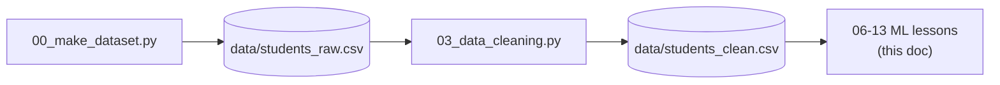
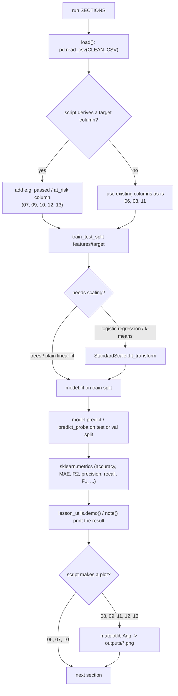
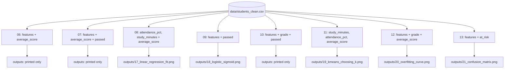

# Flow

How execution moves through `ml_playground`, covering the ML lessons added in `06_supervised_vs_unsupervised.py`
through `13_precision_recall_f1.py` and how they connect to the existing data pipeline (00-05).

## Entry points

- **Per-lesson:** `.venv/bin/python 0N_name.py` — runs that script directly.
- **All lessons:** `./run_all.sh` — runs 00 through 13 in numeric order in one shell, failing fast (`set -euo pipefail`)
  on the first script that raises.
- Every lesson script ends with:
  ```python
  if __name__ == "__main__":
      run(SECTIONS)
  ```
  `run()` (in `lesson_utils.py:37`) is the real entry point once the script is invoked: it iterates a module-level
  `SECTIONS` list of `section_*` functions, printing a `header()` for each from the function's name before calling it.

## The pipeline these lessons depend on



Scripts 06-13 all read `data/students_clean.csv` (built by `03_data_cleaning.py`); none of them write to it or
to `data/students_raw.csv`. They are read-only consumers at the end of the chain, same as `04_exploration.py`
and `05_matplotlib_visualization.py`.

## Execution flow inside one lesson script

Every lesson (06-13) follows the same shape:



1. `load()` reads `data/students_clean.csv` into a `pandas.DataFrame` — every lesson defines its own local
   `load()`, re-reading the CSV fresh per section rather than passing a DataFrame between sections, so each
   `section_*` function stays independently runnable in a REPL (per the project's existing convention).
2. Where the lesson needs a label that doesn't exist in the raw data (`passed`, `at_risk`), `load()` derives it
   with a one-line threshold on `average_score` (see `decisions.md` for why these thresholds were chosen over
   the existing `performance` column).
3. `sklearn.model_selection.train_test_split` splits features (`FEATURES`, a module-level list) from the target,
   with `random_state=0` fixed everywhere for reproducible output across runs. `12_train_val_test_overfitting.py`
   calls it twice to produce three splits (train/validation/test).
4. If the model is scale-sensitive (`LogisticRegression`, `KMeans`), a `StandardScaler` is fit on the training
   split only and applied to both train and test/val — never fit on the full dataset, to avoid leaking test-set
   statistics into the transform.
5. `model.fit(...)` trains; `model.predict(...)` / `model.predict_proba(...)` produces predictions on held-out
   data.
6. `sklearn.metrics` functions (`mean_absolute_error`, `r2_score`, `accuracy_score`, `precision_score`,
   `recall_score`, `f1_score`, `confusion_matrix`, `silhouette_score`, depending on the lesson) turn predictions
   into numbers.
7. `lesson_utils.demo(label, value)` and `lesson_utils.note(text)` print the result and its interpretation —
   this is the actual "lesson" content a reader sees in the terminal.
8. Lessons with a visual component (08, 09, 11, 12, 13) build a `matplotlib` figure on the non-interactive `Agg`
   backend and save it to `outputs/*.png`; `plt.show()` is never called, matching the existing convention from
   `05_matplotlib_visualization.py`.

## Data flow across the eight new lessons



No data flows *between* lessons 06-13 — each is a self-contained read of the same CSV, which is why they can be
run in any order relative to each other (unlike 00→03→04/05, where each step's output is the next step's input).
The numeric ordering (06 before 13) is pedagogical only: later lessons assume the reader already has the
concepts from earlier ones (e.g. 12 and 13 both assume the reader has seen `train_test_split` introduced in 06).

## Conditions and branching worth knowing

- `run_all.sh` exits immediately (`set -e`) if the venv at `.venv/bin/python` doesn't exist, before running any
  script — it checks once up front rather than per script.
- `09_logistic_regression.py` and `13_precision_recall_f1.py` both sweep a *threshold* (`section_the_threshold_is_a_choice`,
  `section_the_tradeoff_is_a_dial_not_a_fact`) rather than branching on a single fixed cutoff — the "branch" is a
  loop over candidate thresholds (`[0.3, 0.5, 0.7]` and `[0.3, 0.4, 0.5, 0.6, 0.7]`), each producing its own
  metrics row, with no single "correct" branch chosen by the code — the lesson's point is that the choice is a
  policy decision, not something the script resolves for the reader.
- `10_decision_trees.py` and `12_train_val_test_overfitting.py` both branch on `max_depth=None` (unlimited) vs.
  a fixed integer depth to contrast overfitting against a constrained model; `12` additionally picks the depth
  programmatically (`int(table["val_mae"].idxmin())` / `int(np.argmin(val_errors))`) rather than hardcoding it,
  so that whichever depth minimizes validation error is the one carried into the final test evaluation.
